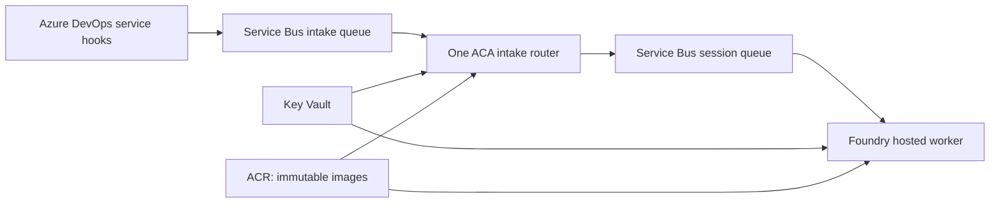

# Repeatable Azure deployment

The same steps work from an operator terminal, Azure Pipelines, Jenkins or another
CI system. The GitHub workflows are wrappers around `build.sh`, `deploy.py` and the
Bicep templates. Configuration contains identifiers and reviewed non-secret settings;
credentials are provisioned separately in Key Vault. See the application's
[Azure setup guide](../../src/docs/azure.deployment.md) for integration and network
requirements, policy settings and acceptance checks.

## Deployment shape



The native ADO connector cannot assign a work-item SessionId. Its intake queue
therefore has sessions disabled. ACA classifies/authorizes events and sends
eligible events to the session queue. The receiver holds a session until its
Foundry job terminates, preserving sequential execution for one work item while
allowing bounded parallel work on different items. Keep one ACA replica, one ASGI
process and one intake router. Ordering is broker enqueue order; retries cannot
promise exactly-once external writes.

## 1. Establish environment prerequisites

Choose a subscription and regions supporting the required ACA and Foundry hosted
agent features, model deployments and quota. Use an existing Foundry account with
project management enabled and an approved network/egress design. The templates
create a dedicated project under that account and leave unrelated projects alone.
They do not create/modify the shared Foundry account, model deployments, Azure DevOps
organization permissions, firewall, private endpoints, DNS or application access.

The reference template creates Basic ACR with admin login disabled, an RBAC Key
Vault with purge protection, Standard Service Bus with two queues, an ingress
user-assigned identity, a VNet-integrated **internal** ACA environment and Log
Analytics diagnostics. Key Vault/Service Bus/ACR retain their public service
endpoints; this is not a complete network isolation template. Review these settings
against the intended network design before applying. Native Service Bus delivery
does not need a public ACA URL. Direct webhooks require a separately approved
gateway/reachable ingress configuration.

The provisioner needs resource-management permissions on the selected resource
groups and role-assignment permission at the exact execution-resource scopes.
The image builder needs `AcrPush`. The reference ACR uses registry RBAC rather
than ABAC repository permissions. The package downloader needs read-only access to
the private Andromeda package. Use short-lived federated CI identities rather than
client secrets. Creating the Foundry project also needs permission in the existing
account's resource group. Register the required resource providers through the
subscription administrator before deployment.

## 2. Prepare reviewed portable configuration

Copy `config.example.json` to a protected path outside the repository, for example
`/secure/stlc/config.json`. Replace every placeholder. Copy only mandatory portable
settings from the local environment: provider/connection selectors, organization,
project, bot identity, mention, status field, models, policies and execution limits.
Do not copy the entire `.env`, local workspace paths, development credentials,
local proxy settings or client IDs belonging to a different workload identity.

The script accepts the application's explicit non-secret allowlist and a small
set of ingress settings. Unsupported variables, including `ADO_PAT`, model keys
and telemetry keys, are rejected. Common policy applies to ingress and worker;
model and API settings belong on the worker. Hosting/identity/queue references
are derived from infrastructure outputs, preventing accidental workstation reuse.

Keep connection IDs stable. `sessionGeneration` also stays stable across ordinary
ingress restarts. Change it deliberately when a release must route to a new Foundry
worker version: existing Foundry sessions retain their original version. New
generations create fresh workspaces and retain old sessions/files. Review any
unfinished progress before switching; an old run reference can still be reattached.

The example uses managed identity for ADO. An ADO administrator must add the
**worker's actual identity** to the organization and grant required work-item,
Test Management and repository permissions. The resource ID
`499b84ac-1321-427f-aa17-267ca6975798` is the Azure DevOps token audience, not an
Azure subscription resource. If organization onboarding is unavailable, an
explicitly approved fallback sets `ADO_AUTH_MODE=pat` and
`STLC_ALLOWED_ADO_AUTH_MODES=pat`, placing only `ADO_PAT` in the worker bundle.
Other Azure access continues to use managed identities. There is no silent fallback.

## 3. Plan and provision infrastructure

Install Azure CLI and Bicep, authenticate with the intended deployment identity,
and run from the repository root. Plans need an existing target resource group;
create it as an administrator if it does not yet exist. Apply creates the target
group if necessary. Keep all generated files outside source control.

```bash
python deployment/azure/deploy.py infrastructure \
  --config /secure/stlc/config.json --output /secure/stlc/infrastructure-plan.json
# Review the what-if output before applying the same configuration.
python deployment/azure/deploy.py infrastructure --apply \
  --config /secure/stlc/config.json --output /secure/stlc/infrastructure.json
```

Existing deployments require an adoption review: use their exact names, regions,
network ranges and settings, including the optional `serviceBusNamespaceName`
override, `serviceBusTags`, `vnetTags`, `acaSubnetDelegationName`, and Foundry
project display name/description when they differ from the defaults. Do not apply example names against a live environment. The template uses
incremental deployment mode and does not remove unrelated resources. A what-if
review is still necessary because updating an existing resource can change settings.

## 4. Bootstrap secrets and integration access

Through the approved administrative secret-entry mechanism, create two separate
Key Vault secrets: the webhook authentication value and the worker runtime JSON
bundle. Names default to `stlc-ado-hook` and `stlc-worker-runtime`. The bundle accepts
only keys in `src/runtime_secrets.py`. Supply the selected model credentials and
explicit ADO fallback credentials only when required. Do not put policy variables
or arbitrary application settings into this bundle. The deployment process never
retrieves secret values or Service Bus keys. Do not grant it routine secret-read
access just to deploy. Secret administration is a separate responsibility; remove
any temporary set-only grants when bootstrap finishes.

The worker loads the bundle using its own identity before importing/executing the
agent. A successful load is cached in the process. After credential rotation,
restart/revise the worker and verify a new native job; changing the vault version
alone does not refresh a running process. Supply application-specific credentials
through an independently approved injection path.

## 5. Build and verify both images

Use Linux amd64, Python 3.12, Docker Buildx and the complete hash-locked Azure
profile. Fetch the approved Andromeda wheel through read-only package access; its
hash must match `src/requirements.azure.txt`. The Docker build receives only the
wheel directory, without package-registry credentials. The main Docker context is
an allowlist and excludes `.env`, local workspaces, traces and operator receipts.

```bash
# Authentication to the private package repository happens outside the image.
python -m pip download --require-hashes -r src/requirements.azure.txt \
  --dest /secure/stlc/wheels
python -m pip install --no-index --find-links /secure/stlc/wheels \
  --require-hashes -r src/requirements.azure.txt
python -m pip check
python -m pytest -q src/tests
python -m unittest discover -s deployment/azure/tests -v
bash deployment/azure/build.sh <acr-name> <release-id> \
  /secure/stlc/wheels /secure/stlc/images
```

The build script launches Chromium as UID 10001 before publishing the worker,
then records both immutable image digests. It uses a temporary private Docker
credential directory and removes it on exit. Playwright and its browser revision
must match the automation repository lock. Base images are currently version tags;
record resolved base digests and pin approved digests for a fully reproducible release.

Foundry mounts persistent `$HOME=/home/session` after the image is built. A fixed
isolated Python bootstrap initializes that directory, then permanently drops to
UID/GID 10001 before starting Andromeda. Preserve the session home: moving it to
`/tmp` loses native job records and breaks queue recovery. The ingress starts as
appuser directly. No privileged container setting is required.

## 6. Plan and apply the application release

```bash
python deployment/azure/deploy.py release \
  --config /secure/stlc/config.json --infrastructure /secure/stlc/infrastructure.json \
  --images /secure/stlc/images/images.json --output /secure/stlc/release-plan
python deployment/azure/deploy.py release --apply \
  --config /secure/stlc/config.json --infrastructure /secure/stlc/infrastructure.json \
  --images /secure/stlc/images/images.json --output /secure/stlc/release
```

The release assigns resource-scoped image-pull, Service Bus, Foundry invocation and
per-secret permissions to separate identities. It deploys a version of the named
main worker, grants its returned identity access to its runtime bundle, waits for
activation, and submits a deliberately invalid readiness job. Its expected
`KeyError` happens **after** secret loading and **before** any model or integration
call. This proves native session/job storage is writable; it does not prove a QA
workflow. A successful readiness session is deleted; a failed one is identified
for inspection. Permission propagation may require waiting and rerunning readiness.

Reconcile/drain current work before a planned release. The script deactivates old
ACA revisions, verifies their replicas have stopped, and waits for the live intake
queue's lock duration plus five seconds before starting the replacement. The
optional Bicep `intakeLockDuration` parameter defaults to `PT1M`; the release reads
the deployed queue value so parameter overrides do not shorten this wait. This introduces a
short intake pause while Service Bus retains events. It prevents overlapping
intake routers from reordering the same work item. Existing worker jobs continue;
the receiver reattaches recorded runs using queue session state. A failed release
stops and may leave intake paused: inspect the recorded worker/session/revision
state before resuming. Do not blindly replay events or roll back the session
generation. Keep the previous digests/configuration and preserve real session files.

The final ACA readiness probe requires connected queue receivers. Check runtime
logs and queue counts after rollout; app provisioning success alone does not
establish complete delivery. No destructive cleanup of agent names, old versions,
work-item sessions or external work items occurs in this automation.

## 7. Configure service hooks and prove the actual cloud path

Create a queue-scoped **Send-only** rule on the intake queue. Enter its SAS
connection string through the ADO service-hook UI using a secure operator workflow.
Use the **namespace form without `EntityPath`**: the legacy connector constructs a
namespace manager and rejects entity-path connection strings even when the policy
is correctly queue-scoped. Set queue name `stlc-events` separately. Enable **Send
as non-serialized string**, retain all resource/message/detailed-message fields,
and create scoped assignment and comment subscriptions. Do not enable sessions on
the intake queue. Keep the session-enabled `stlc-work-items` queue private to ACA.

Test the new hooks before cutover. Disable overlapping old direct/local
subscriptions and retain rollback configuration securely outside the repository.
Match a pilot event to its broker submission/run ID, Foundry version/session and
the actual `work_comment_add` result ID. A bot display name or response wording
cannot distinguish local and cloud workers. Exercise two events on one work item
and events on different items to verify sequencing and concurrency. Confirm no
unexpected dead letters; an active work-queue message is normal while a job runs.
Finally run representative Playwright tests in Foundry and verify report/evidence
uploads, repository access and denied-scope behavior. A local browser smoke test
and an acknowledgment comment do not establish hosted QA execution.

Console/system logs use Azure Monitor diagnostics without workspace keys. In this
configuration query the `ContainerAppConsoleLogs` table (`TimeGenerated`,
`ContainerAppName`, `Log`). Allow for ingestion delay and use live console/session
logs for immediate diagnosis. Remove only diagnostic agents/sessions created by
the operator; keep the main agent and real work-item sessions.

## GitHub workflow configuration

Create protected GitHub environments and configure OIDC trust for their exact
repository/environment subjects in Azure and, when using CodeArtifact, AWS.
Restrict allowed branches/reviewers on deployment environments. The workflows do
not run deployment on pull requests or pushes. Build and deployment can use
different environments/identities so the builder needs only registry push access.

| Environment variable | Purpose |
| --- | --- |
| `AZURE_CLIENT_ID`, `AZURE_TENANT_ID`, `AZURE_SUBSCRIPTION_ID` | Azure federated login; use a build or deployment identity as appropriate |
| `AZURE_ACR_NAME` | Build destination registry |
| `AWS_CI_ROLE_ARN`, `AWS_REGION` | Federated read-only private-package access |
| `CODEARTIFACT_DOMAIN`, `CODEARTIFACT_DOMAIN_OWNER`, `CODEARTIFACT_REPOSITORY` | Package location; all are explicit, with no organization-specific defaults |
| `STLC_AZURE_CONFIG_JSON` | Reviewed non-secret contents of the configuration file for deployment |

Application secret values stay in Key Vault and are not GitHub workflow inputs,
variables, artifacts or image layers. Both workflows default operator tracing off.
Build downloads/install checks the full Azure lock and runs tests before publishing;
its artifact contains digest references only. Deployment defaults to a plan and
serializes changes per target environment with cancellation disabled.

Run **Azure deployment → infrastructure → apply=false** and review the plan, then
apply it. For the first deployment, complete the separate secret/ADO bootstrap.
Run **Azure images** on the approved source revision and obtain its worker/webhook
digests. Run **Azure deployment → release**, enter those same immutable digests,
review its plan, then apply. Infrastructure outputs are read from the named
`stlc-infrastructure` ARM deployment. For an existing manually provisioned stack,
adopt it through a reviewed infrastructure deployment first, or use the CI-neutral
script with an independently verified outputs file. A plan does not deploy, and
these checked-in workflows require environment identities/variables before their
first remote run. The deploy workflow currently targets GitHub-hosted Ubuntu;
adapt `runs-on` for a controlled runner when network access requires it.

For another CI platform, preserve the same stages and artifacts: federated login,
infrastructure what-if/apply, separate secret bootstrap, locked dependency tests,
container/browser build, digest promotion, worker readiness, serialized ACA rollout,
then real event acceptance. Do not rebuild different images between plan and apply.
Never commit environment receipts, real parameter files, `.env`, runtime logs,
private wheel bundles or local editor settings.
